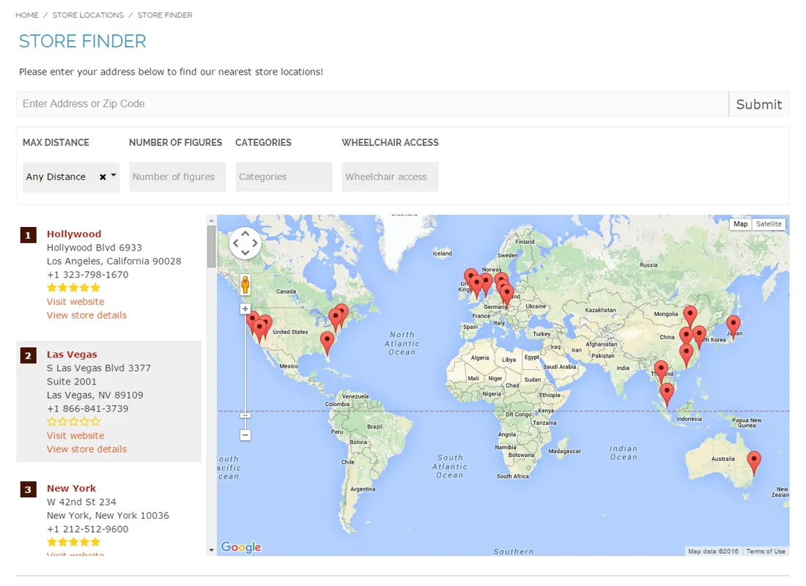
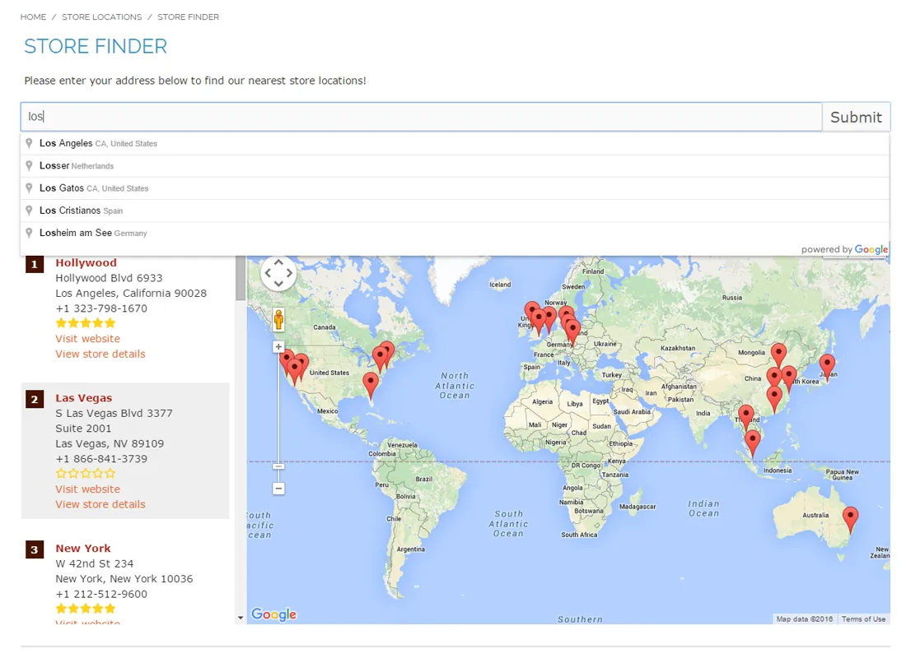
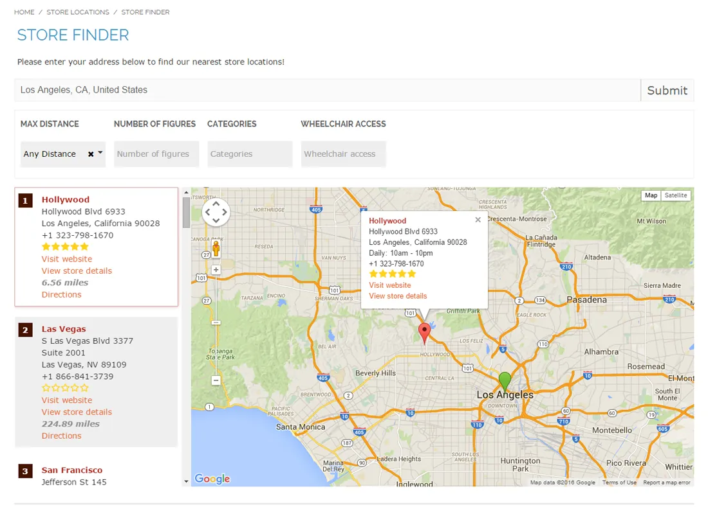
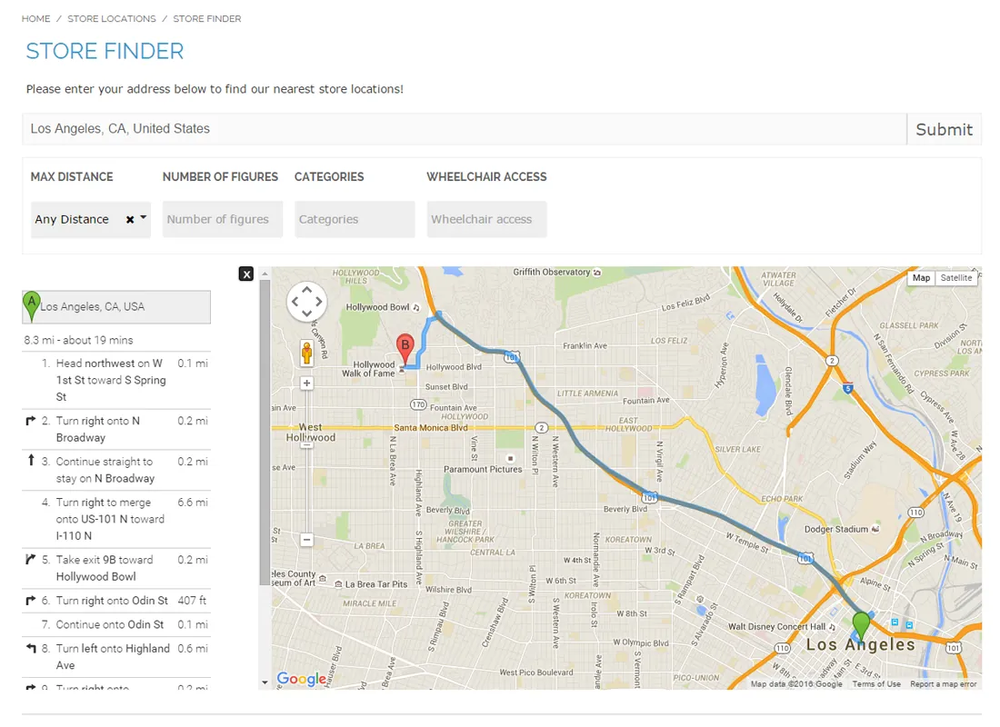
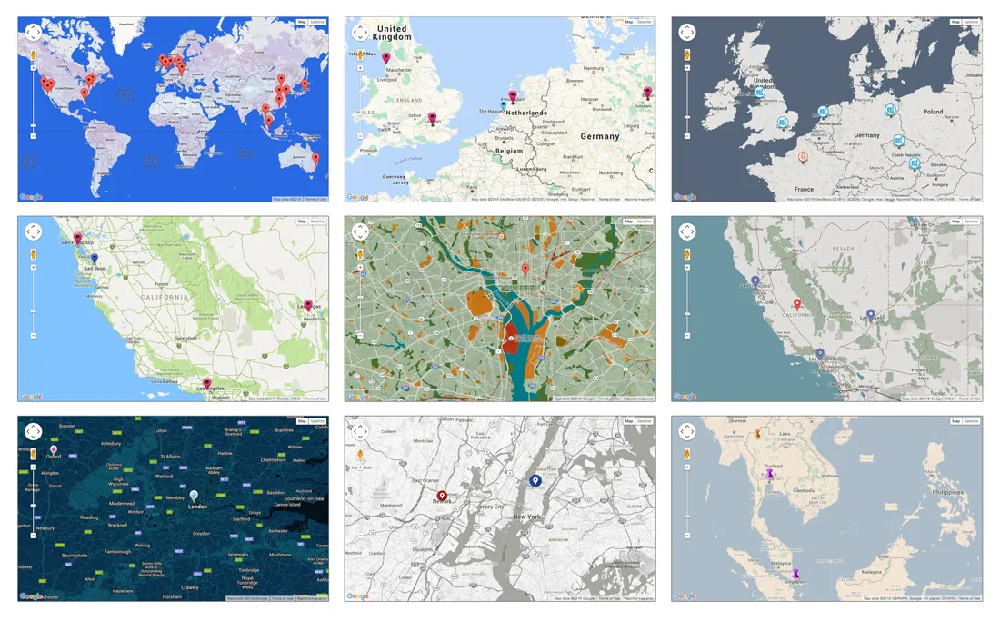
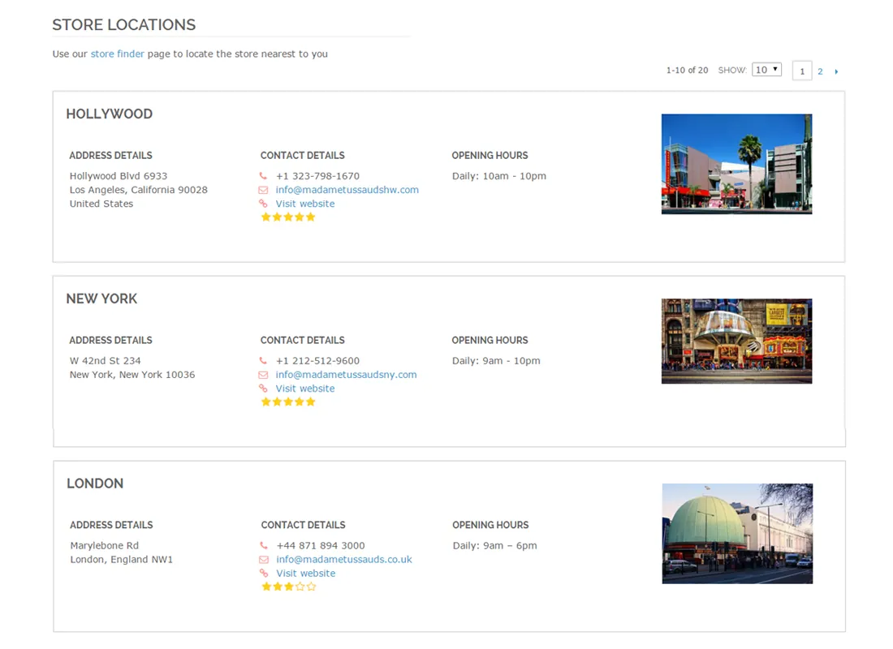
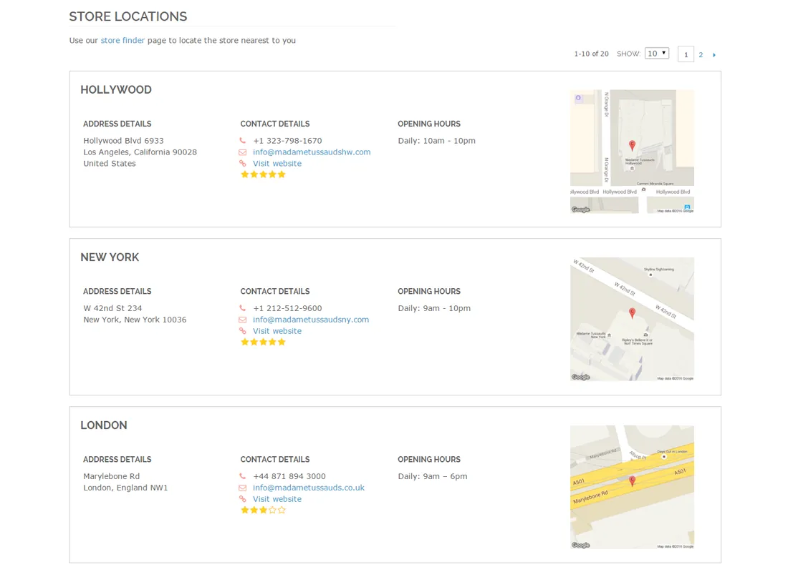

# Store Finder for Magento 1 / OpenMage

**Store locator with Google Maps and store information pages for Magento.**



Adds a Google Maps store locator with route planner, a store locations overview and a dedicated page for each store.

Store pages can show opening hours, images, custom store attributes and customer reviews.

> [!NOTE]
> Store Finder is free and open source under the MIT License (since 2026). Plugin Company no longer actively develops this extension, but issues and pull requests are welcome.

## Features

### Store locator features

- Responsive Google Maps store locator
- Door-to-door route planner
- Address auto-completion and automatic geocoding
- Distances in miles or kilometers
- Optional radius and custom attribute filters
- Many store locator display options
- Optional product page integration

### Store page features

- Dedicated information page per store
- Contact details, opening hours and map location
- Descriptions, images and custom store attributes
- Customer reviews and ratings
- Store locations overview page
- CSV import and export

## Screenshots

<table>
  <tr>
    <td width="50%" valign="top"><br><sub>Address autocompletion</sub></td>
    <td width="50%" valign="top"><br><sub>Interactive store map</sub></td>
  </tr>
  <tr>
    <td width="50%" valign="top"><br><sub>Integrated route planner</sub></td>
    <td width="50%" valign="top"><br><sub>Custom store locator themes &amp; icons</sub></td>
  </tr>
  <tr>
    <td width="50%" valign="top"><br><sub>Store locations list page with custom images</sub></td>
    <td width="50%" valign="top"><br><sub>Store locations list page with Google Maps location</sub></td>
  </tr>
</table>

More screenshots are on the [product page](https://plugin.company/magento1-extensions/store-finder.html).

## Compatibility

- **Magento:** Community Edition 1.4.x – 1.9.x, Enterprise Edition 1.8.x – 1.14.x
- **Latest version:** 1.14.2 (released 2020-01-12)
- **Composer package:** `plugincompany/magento1-store-finder`
- **Module:** `Plugincompany_Storelocator`

## Installation

### modman

```bash
cd /path/to/magento
modman init   # once per Magento installation
modman clone https://github.com/PluginCompany/magento1-store-finder.git
```

modman creates symlinks, so enable *Allow Symlinks* under System > Configuration > Advanced > Developer > Template Settings.

### Composer

With [magento-hackathon/magento-composer-installer](https://github.com/Cotya/magento-composer-installer) (it reads the `modman` file of this repository):

```bash
composer config repositories.plugin.company composer https://plugin.company/
composer require plugincompany/magento1-store-finder
```

Your project `composer.json` needs the Magento root directory in its `extra` section (and, with Composer 2.2+, the installer plugin allowed), for example:

```json
{
    "extra": { "magento-root-dir": "./" },
    "config": { "allow-plugins": { "magento-hackathon/magento-composer-installer": true } }
}
```

### Manual installation

Download the ZIP of the latest release from the [tags page](https://github.com/PluginCompany/magento1-store-finder/tags) ([1.14.2](https://github.com/PluginCompany/magento1-store-finder/archive/refs/tags/1.14.2.zip)) and copy the `app/`, `js/`, `skin/` folders into your Magento root:

```bash
unzip magento1-store-finder-1.14.2.zip
cp -R magento1-store-finder-1.14.2/app magento1-store-finder-1.14.2/js magento1-store-finder-1.14.2/skin /path/to/magento/
```

Step-by-step instructions are in the [installation guide](docs/02-installing-the-magento-extension.md).

### After installing

Clear the cache (System > Cache Management, or `rm -rf var/cache/*`), then log out of the admin and log in again so the new configuration sections and permissions are loaded.

> [!NOTE]
> Some files of this extension are also shipped by other Plugin Company Magento 1 extensions: `js/plugincompany/jquerynoconflict.js` (also in 8 other extensions). The original ZIP packages simply overwrote each other's copy; with modman or the Composer installer the second extension reports an existing target for these paths.

### Upgrading from a purchased copy

Replace the old files with this release. No license key is needed; your settings and data stay as they are.

## Documentation

- [Documentation in this repository](docs/README.md) (Installation Guide, User Manual)
- Online documentation: <https://plugin.company/knowledge-base/docs/magento-store-finder/>
- Product page: <https://plugin.company/magento1-extensions/store-finder.html>

## Changelog

See [CHANGELOG.md](CHANGELOG.md) for the release history.

## Contributing

Found a bug or have an improvement? Please open an [issue](https://github.com/PluginCompany/magento1-store-finder/issues) or send a [pull request](https://github.com/PluginCompany/magento1-store-finder/pulls). Since the extension is no longer actively developed by Plugin Company, fixes from the community are the best way to keep it working on current Magento 1 / OpenMage and PHP versions.

## License

Plugin Company's code in this repository is released under the [MIT License](LICENSE), Copyright (c) 2014-2026 Plugin Company.

Bundled third-party libraries keep their own licenses; see [THIRD-PARTY-NOTICES.md](THIRD-PARTY-NOTICES.md) for the full list.
