# Configuring the Store Finder Extension

To configure the extension, navigate to **System > Configuration** in the top Admin Panel menu and select **Store Finder** from the left side menu.

Using the config page you can modify the Store Finder general settings and the front-end display options of the following extension features:

- [Store Page Settings](#store-page-config): each store location has a dedicated store page including address, contact details, opening hours, Google Maps location, a store description and uploaded store image. Besides that you can add an Additional Details section with custom store attributes and a Customer Comments section to the store page. See the chapter on [managing store locations](./05-managing-store-locations.md) to configure the content and settings of each store page.
- [Store Locations Settings](#store-locations-config): the Store Locations list page shows an overview of all your stores, including the most important visitor information and a link to the dedicated store page.
- [Store Finder Settings](#store-finder-config): the Store Finder page includes the Google Maps based store locator with integrated route planner.
- [Product Page Settings](#product-page-config): by enabling the extension's product page integration, customers can search for store locations directly on the product page.

It’s possible to configure the extension per store view by changing the 'Current Configuration Scope' at the top left corner of the page.

To save any changes made in the Store Finder settings, click the 'Save Config' button in the top right corner of the configuration page.

## General Settings

In the extension's General Settings you can:

- Enable the extension for the current store view.
- Enable breadcrumbs to show the breadcrumbs navigation at the top of all Store Finder pages.
- Enter a default URL prefix and suffix for the Store Finder page and dedicated store pages, for example: `https://www.example.com/stores/{urlkey}.html`. The URL key can be configured for each page separately (see [Store Finder Settings](#store-finder-config) and [Store Page Settings](./06-store-information.md)).
- Enter your personal[Google Maps API key](https://developers.google.com/maps/documentation/javascript/get-api-key), which in some cases needs to be added in case Google Maps API errors are encountered in the front- and back-end Store Finder pages.

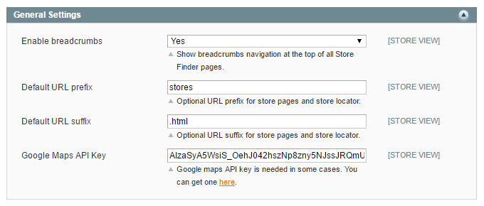

## Javascript / CSS Libraries

You can choose to include the Store Finder Javascript and CSS libraries. Select 'No' if your store theme already includes jQuery or Font Awesome.

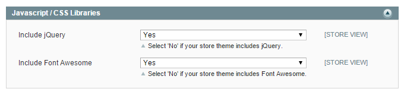

## Store Page Settings

In the Store Page Settings you can configure whether guests and/or logged in customers are allowed to review and rate your stores in the Customer Comments section of [dedicated store pages](./13-store-finder-frontend-examples.md#store-page-example).

You can also enable the Customer Comments section for each store separately in the [Store Information](./06-store-information.md) tab.

By enabling the store rating option, customers can rate the store when leaving a comment with up to five stars.

Logged in customers can view their submitted reviews in the Store Locations Comments tab of their customer account.

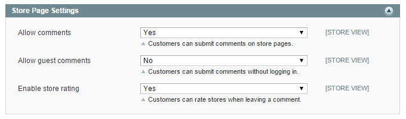

## Store Locations Settings

In the Store Locations Settings you can:

- Configure a custom URL key for the [Store Locations list page](./13-store-finder-frontend-examples.md#store-locations-example), which shows an overview of all your stores.
- Enter a comma-separated options list for the Store Locations page filter, which can be used to select the amount of store locations shown per page.
- Set a default amount of store locations shown per page, which should be a value that's included in the filter options. Enter 'all' to show all store locations on one page.
- Choose to show a custom store image in the list view instead of the default Google Maps location image, which can be uploaded in the [Store Information](./06-store-information.md) tab.
- Optionally add a Store Locations link to your store's top menu, header and/or footer links. Please note that the menu item is only compatible with Magento Community editions 1.7 and above and that the header link will be placed in the Account dropdown menu in Magento 1.9 and above.
- Enter a custom Store Locations title for the menu item and header/footer links.
- Add the Store Locations meta data, including page title, description and keywords.

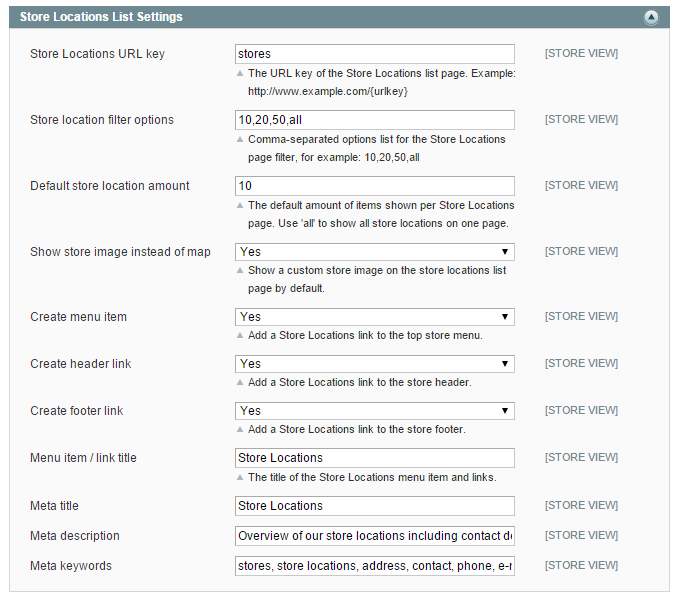

## Store Finder Settings

In the top section of the Store Finder Settings you can:

- Configure a custom URL key for the [Store Finder page](./13-store-finder-frontend-examples.md#store-finder-example) which includes the Google Maps based store locator and route planner.
- Enter a custom Store Finder page title and description, which are shown above the store locator.
- Optionally add a Store Finder link to your store's top menu, header and/or footer links. Please note that the menu item is only compatible with Magento Community editions 1.7 and above and that the header link will be placed in the Account dropdown menu in Magento 1.9 and above.
- Enter a custom Store Finder title for the optional menu item and header/footer links.
- Add the Store Finder page meta data, including page title, description and keywords.

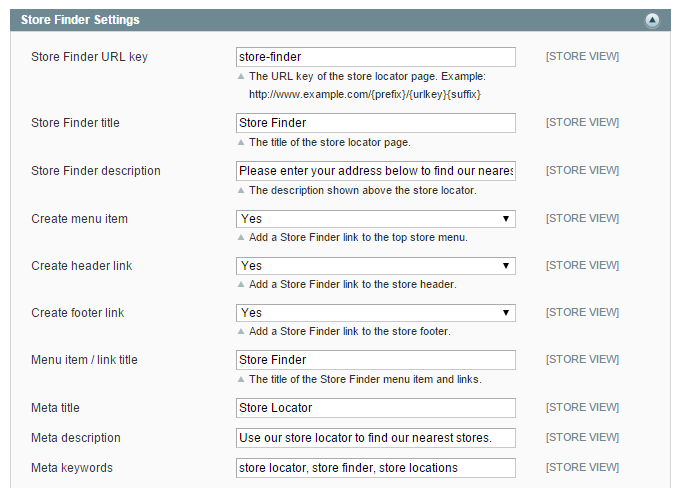

In the bottom section of the Store Finder Settings you can:

- Enable auto-geocoding, allowing the store locator to automatically try to detect the visitor's location.
- Configure a default map location, which will be used if the visitor's location isn't specified or detected.
- Select the measurement unit for calculating map distances, which can be set to miles or kilometers.
- Enable radius selection, adding a maximum distance filter menu to the store locator.
- Enter a comma-separated options list for the radius selection filter.
- Set a default radius selection, which should be a value that's included in the filter options. Leave the field empty to use any distance.
- Enable the store name filter option.
- Select a default map zoom level which is used when the visitor's location is specified or detected.
- Configure the maximum amount of store locations shown on the map at once. Enter '-1' to show all your store locations.
- Choose to mark the visitor's location on the map and optionally upload custom marker images.
- Change the map theme by adding a custom JavaScript style array in the text area. You can find a large collection of free Google Map themes on [snazzymaps.com](https://snazzymaps.com), where you can simply copy the desired theme style and paste it into the 'Custom map theme' area (see [custom map theme front-end examples](./13-store-finder-frontend-examples.md#theme-examples)).

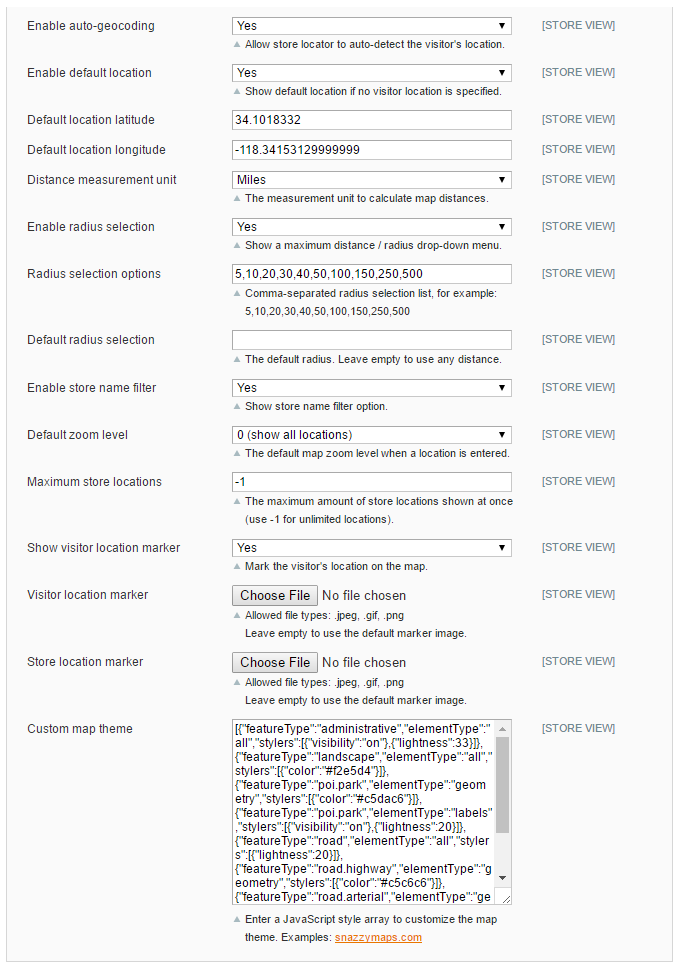

## Store Finder Preview Links

The Store Finder Preview Links section shows the front-end URL(s) of your Store Finder page(s), which are updated when saving changes made in the [Store Finder Settings](#store-finder-config).

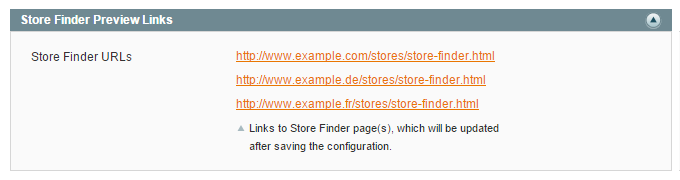

## Product Page Settings

In the Product Page Settings you can optionally enable the Store Finder[product page integration](./13-store-finder-frontend-examples.md#product-page-example), enabling customers to find stores based on their product availability using the Store Locations and/or Store Finder tab in the product details menu.

If you choose to manually manage the store location inventory, you can select the available products for each store in the [Store Products](./09-store-products.md) tab.

Vice versa you can also select the available store locations for each product in the Store Locations tab of the product view (**Catalog > Manage Products**).

If you disable the 'Select store location products' option, all your store locations will be displayed in the product details menu by default.

You can separately enable the auto-geocoding function for the product page Store Finder tab, which will only work if this option is enabled in the [Store Finder Settings](#store-finder-config) as well.

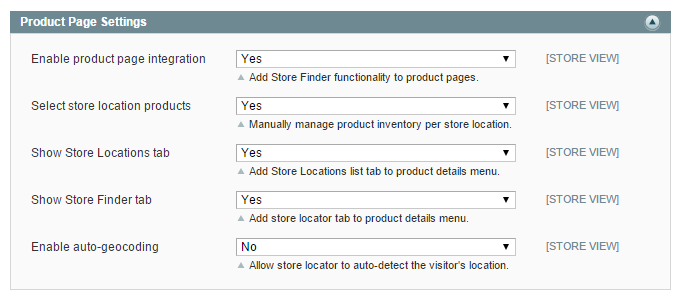

## Cache Settings

In the Cache Settings you can optionally enable the store locations cache.

The cache lifetime in seconds defines how long the store location data is cached before refreshing it.

If the store locations cache is enabled, you need to rebuild the Store Finder cache after editing your store locations in order to show the changes on the front-end.

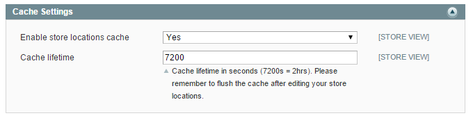

To rebuild the Store Finder cache, navigate to **System > Cache Management** and click 'Flush Store Finder Cache' at the bottom of the page.

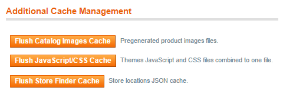

## Iframe Embedding

In this section you can find the Store Finder Iframe embed code(s) which can be used on external websites.

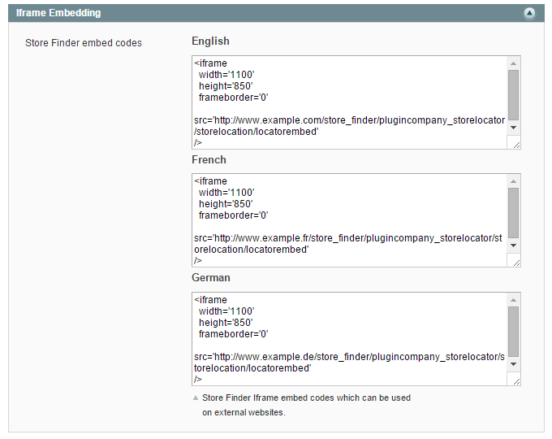

---

[Documentation index](./README.md) · [README](../README.md) · [Online version](https://plugin.company/knowledge-base/docs/magento-store-finder/user-manual/configuring-the-store-finder-extension/)
