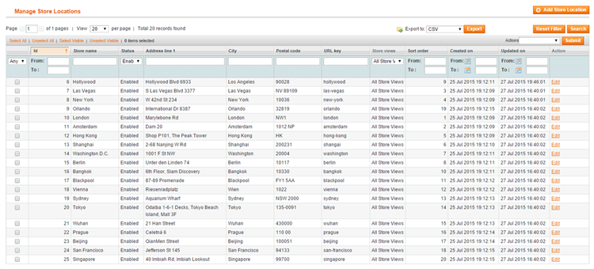

# Managing Store Locations

To manage your store locations and dedicated store pages, navigate to **CMS > Store Finder > Manage Store Locations** in the top Admin Panel menu.

Select a store location from the grid to edit it, or create a new location by clicking the 'Add Store Location' button in the top right corner of the page.

Use the following tabs of the store view menu to create and configure your store locations and store pages:

- [Store Information](./06-store-information.md)
- [Store Location](./07-store-location.md)
- [Custom Store Attributes](./08-custom-store-attributes.md)
- [Store Products](./09-store-products.md)
- [Store Meta Data](./10-store-meta-data.md)
- Store Views (for multi-store setup)

---

[Documentation index](./README.md) · [README](../README.md) · [Online version](https://plugin.company/knowledge-base/docs/magento-store-finder/user-manual/managing-store-locations/)
