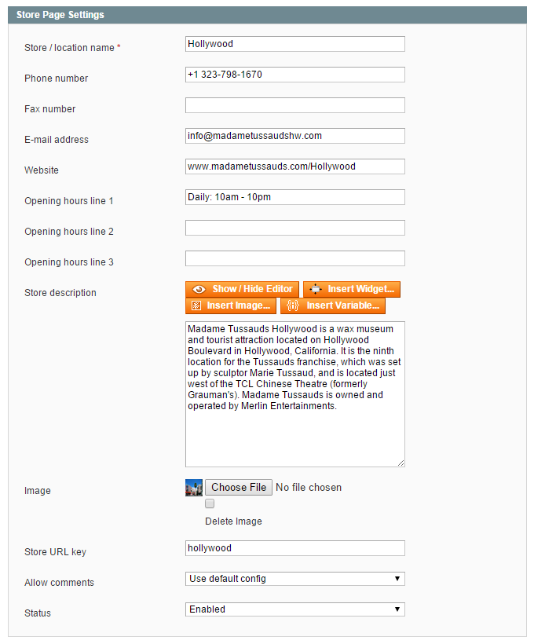
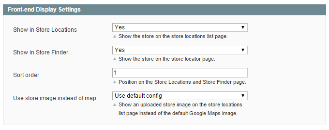

# Store Information

In the Store Information tab you can configure the content and settings of the dedicated store page and the front-end display options of the Store Locations and Store Finder page as further explained below.

## Store Page Settings

In the top section of the Store Information tab you can:

- Enter the store name, contact details and opening hours which are shown in the top section of the dedicated store page (the website URL should be entered without the http:// prefix).
- Add a store description and upload a custom store image.
- Configure a custom URL key for the store page.
- Enable the Customer Comments section for this specific store page, or use the [default configuration](./04-configuring-the-store-finder-extension.md#store-page-config).
- Enable the store location to include it in the front-end Store Finder pages.

## Front-end Display Settings

In the bottom section of the Store Information tab you can:

- Choose whether the store page should be included in the Store Locations list page and Store Finder page.
- Define the store's sort order on these pages, which by default sort store locations by their ID.
- Choose to use the uploaded store image on the Store Locations list page instead of the default Google Maps image, or use the [default configuration](./04-configuring-the-store-finder-extension.md#store-locations-config).

---

[Documentation index](./README.md) · [README](../README.md) · [Online version](https://plugin.company/knowledge-base/docs/magento-store-finder/user-manual/store-information/)
