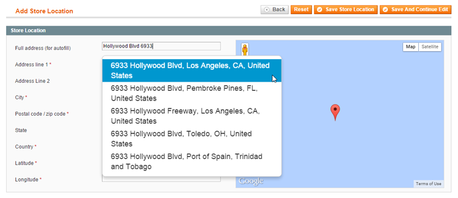
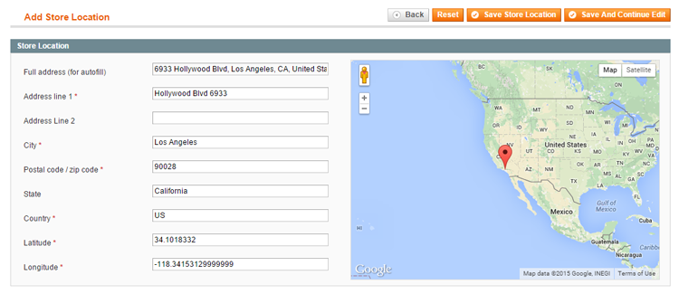
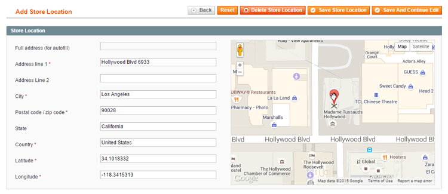
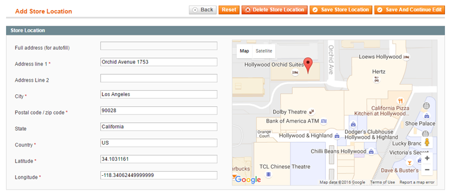

# Store Location

In the Store Location tab you can configure the store's physical location for the Store Finder page and the Google Maps location shown at the top of the store page.

By entering an address in the 'Full address' field, a dropdown menu will appear which can be used to auto-complete the store location details.

Of course you can also enter the address manually or edit the auto-completed details. The map on the right will automatically show the corresponding location, marked with a red place mark.

You can click and drag the map to change its focus and adjust its zoom level and map view.

Alternatively, it's possible to change the store's location by dragging an dropping the map's place mark to another position, which will automatically update the address details on the left.

---

[Documentation index](./README.md) · [README](../README.md) · [Online version](https://plugin.company/knowledge-base/docs/magento-store-finder/user-manual/store-location/)
