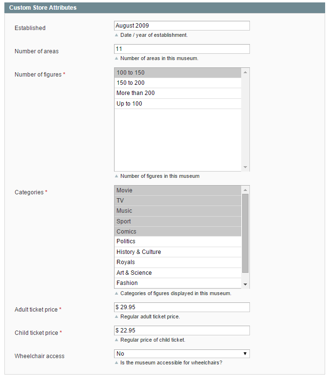
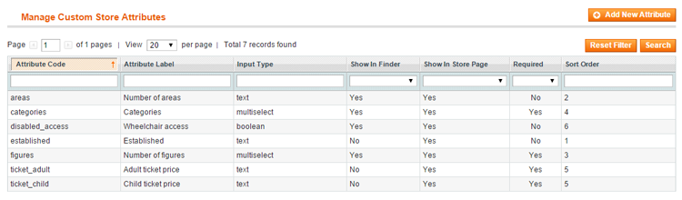
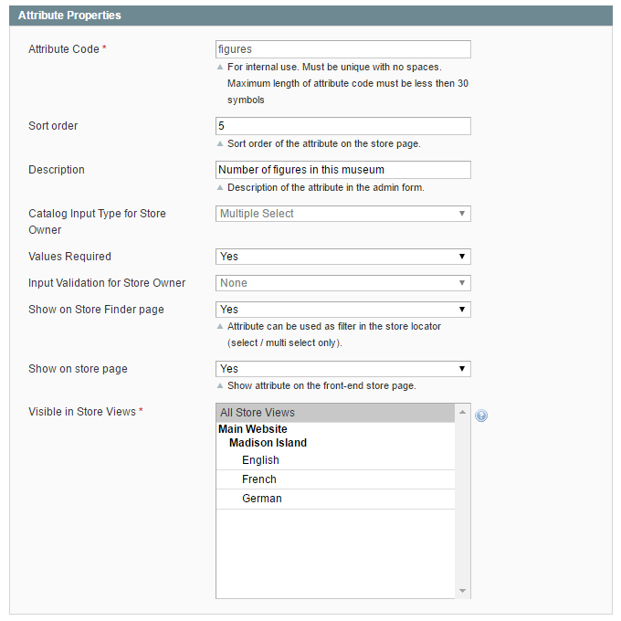
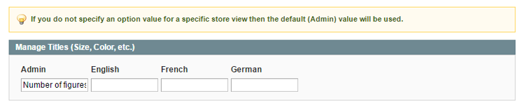
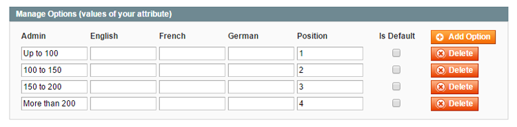

# Custom Store Attributes

If you'd like to add custom details to store pages, you can [create custom store attributes](#create-attributes) which can be configured per store location in the Custom Store Attributes tab.

The custom store attributes will be displayed in the Additional Details section of the [store page](./13-store-finder-frontend-examples.md#store-page-example) and can also be used as filters on the [Store Finder page](./13-store-finder-frontend-examples.md#store-finder-example).

## Creating Custom Store Attributes

To create and manage store attributes, navigate to **CMS > Store Finder > Custom Store Attributes** in the top Admin Panel menu and click 'Add New Attribute' in the top right corner of the page.

### Attribute Properties

In the Attribute Properties tab you can:

- Enter a attribute code/name for admin reference.
- Define the sort order of the attribute on the front-end store page.
- Add a description of the attribute for admin reference which is used in the Custom Store Attributes tab.
- Select one of following attribute input types: Text Field, Text Area, Date, Yes/No, Multiple Select or Dropdown.
- Optionally enter a default attribute value. (For the 'Multiple Select' and 'Dropdown' input types you can configure the default value in the Attribute Label / Options tab.)
- Choose an input validation method if the selected input type is a text field.
- Choose to show the attribute on the Store Finder page and/or in the Additional Details section of the dedicated store page. Please note that only attributes with the input type 'Yes/No', 'Multiple Select' or 'Dropdown' can be used as store locator filters on the Store Finder page.
- Select the Store View(s) in which the attribute should be visible.

### Attribute Label / Options

In the Manage Titles section you need to enter a label for the store attribute which will be shown on the front-end store page.

In case of multiple store views, you can enter a label for each store view separately or use the default 'Admin' label for all store views.

If you have selected the 'Multiple Select' or 'Drop-Down' input type, you can add the attribute options in the Manage Options section by clicking the 'Add Option' button on the right.

Same as with the attribute label, you can enter an option name for each store view separately or use the default 'Admin' value for all store views.

You can select one or multiple default options by ticking the 'Is Default' box on the right and define the sort order of the options in the 'Position' field.

---

[Documentation index](./README.md) · [README](../README.md) · [Online version](https://plugin.company/knowledge-base/docs/magento-store-finder/user-manual/custom-store-attributes/)
