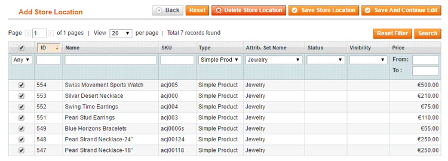

# Store Products

If you have enabled product page integration in the [Product Page Settings](./04-configuring-the-store-finder-extension.md#product-page-config) and choose to manually manage the store location inventory, you can select the available products in this specific store location in the Store Products tab.

Please note that the Store Products tab will be hidden if all products are available in each store by default.

It's also possible to select the available store locations for each product in the Store Locations tab of the product view (**Catalog > Manage Products**).

---

[Documentation index](./README.md) · [README](../README.md) · [Online version](https://plugin.company/knowledge-base/docs/magento-store-finder/user-manual/store-products/)
