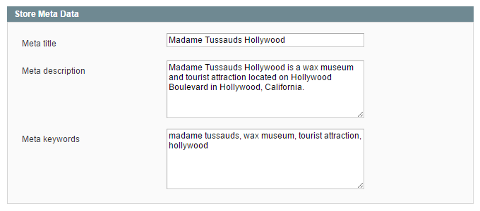

# Store Meta Data

In the Store Meta Data tab you can enter the store page meta title, description and keywords.

---

[Documentation index](./README.md) · [README](../README.md) · [Online version](https://plugin.company/knowledge-base/docs/magento-store-finder/user-manual/store-meta-data/)
