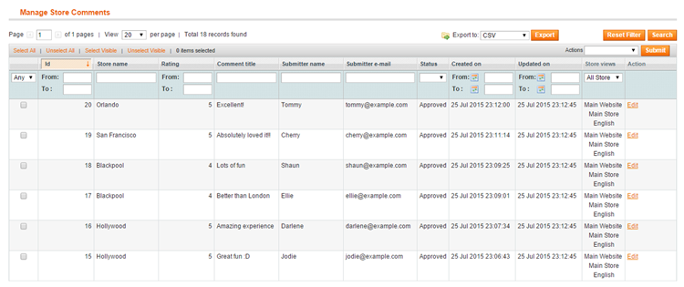
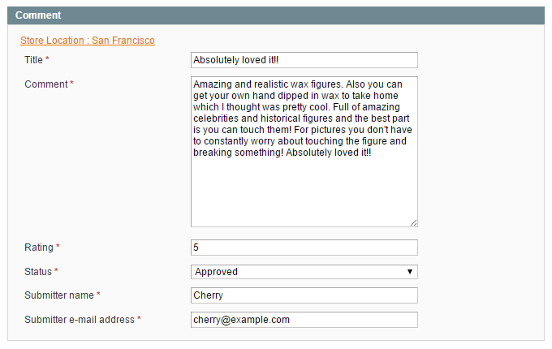

# Managing Store Comments

If store comments are enabled in the extension's [config screen](./04-configuring-the-store-finder-extension.md#store-page-config) and individual [Store Page Settings](./06-store-information.md), submitted reviews and ratings can be managed by navigating to **CMS > Store Finder > Manage Store Comments** in the top Admin Panel menu.

Select a comment from the list to modify it or change its status.

You can change the status of multiple comments at once using the 'Actions' dropdown menu in the top right corner of the page.

The comment will not be shown on the front-end store page unless it has been approved by a moderator.

Using the store location link at the top of the Store Comment tab you can view the store page in the back-end.

In the Store Views tab you can choose in which store(s) the comment should be shown (in a multi-store setup).

By default the store view is selected in which the comment has been submitted.

---

[Documentation index](./README.md) · [README](../README.md) · [Online version](https://plugin.company/knowledge-base/docs/magento-store-finder/user-manual/managing-store-comments/)
