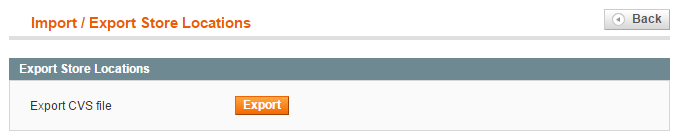
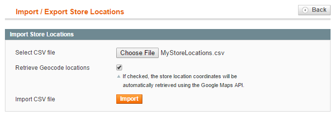

# Importing and Exporting Stores

To import or export store locations in CSV format, navigate to **CMS > Store Finder > Import / Export Stores** in the top Admin Panel menu.

The Store Finder import and export functionality can be used to quickly create or edit multiple store locations at once.

## Export Store Locations

Click the 'Export' button in the Export Store Locations tab to download all existing stores to a CSV file.

## Import Store Locations

Open the Import Store Locations tab to import stores from a CSV file.

Best practices for importing store locations are provided below as well as in the bottom section of the Import Store Locations tab.

### Importing New Store Locations

The easiest way to import new stores is to create one store location manually first, run an export and use the resulting CSV file as a template.

Because custom store attributes without values are not exported, it's recommended to assign a value to each custom attribute before running an export.

To import new store locations, simply leave the 'entity_id' column of the CSV template blank or completely remove it.

Fill the other columns with the desired store data and import the saved CSV file in the Import Store Locations tab.

### Updating New Store Locations

To update existing store locations, run a CSV export of your stores and modify the store data where necessary, making sure to keep the 'entity_id' column intact.

Import the updated and saved CSV file in the Import Store Locations tab.

### Updating Specific Data Only

When importing store locations, only the values of the columns included in your CSV file are updated; the values of attributes that are not included in the CSV file are left as is.

When updating specific data only, your CSV file should at least contain the 'entity_id' column and one (custom) attribute column.

### Importing Store Images

To import store images using a CSV template:

- Upload the store images to the following directory on your web server, in which **[magentodir]** is the root folder of your Magento installation: **[magentodir]/media/storelocation/import/**
- Enter the following data in the 'image' column of your CSV template: **/import/[filename].[ext]** in which **[filename]** refers to the file name of the image and **[ext]** to the file extension.
- For example, when importing the following image: **media/storelocation/import/myimage.jpg**, the value entered in the CSV template would be: **/import/myimage.jpg**

### Retrieving Geocode Locations

Based on the entered address in the CSV file, the Store Finder extension can automatically calculate the store location coordinates during import using the Google Geocode Location API.

These coordinates are used to define the exact map location which is shown on the front-end store page.

To auto-calculate the store location coordinates during import, check the 'Retrieve Geocode locations' box in the Import Store Locations tab.

The Google API will only calculate the coordinates of the stores that have no longitude and latitude values ('lng' and 'lat' columns) in the CSV file.

The Google Geocode Location API is limited to 2000 requests per 24 hours. When importing a large store database it's therefore recommended to only check the 'Retrieve Geocode locations' box on the final import, so you won't use up the Geocode API limit while testing.

Because the Google Geocode API is also limited to 5 requests per second, it might take a while to import a large number of store locations at the same time (approx. 1000 stores per 3-4 minutes).

---

[Documentation index](./README.md) · [README](../README.md) · [Online version](https://plugin.company/knowledge-base/docs/magento-store-finder/user-manual/importing-and-exporting-stores/)
