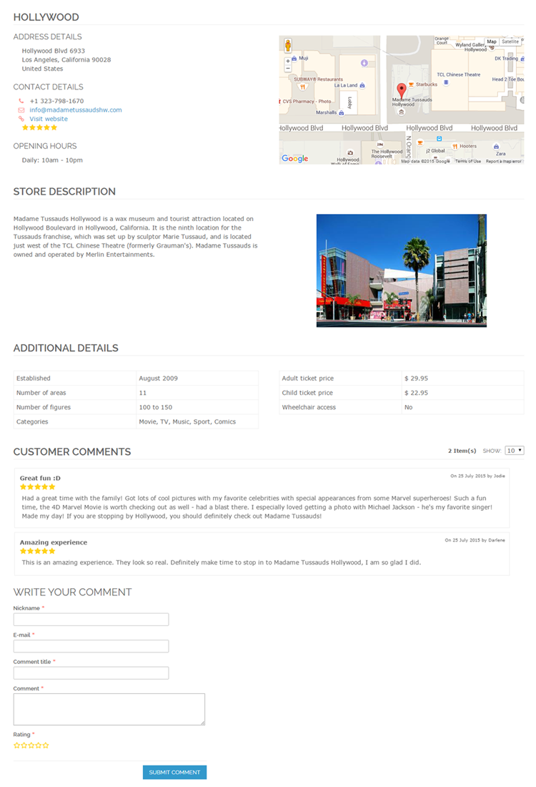
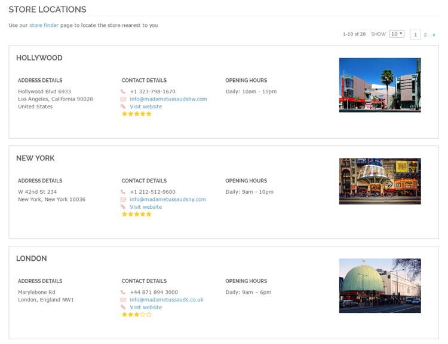
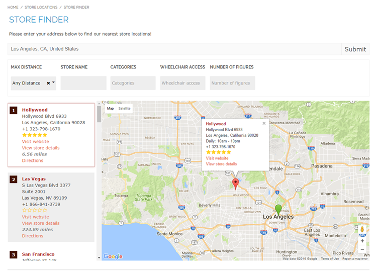
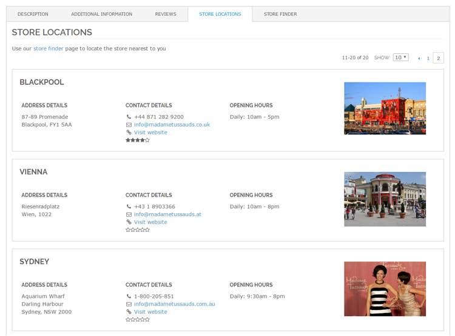
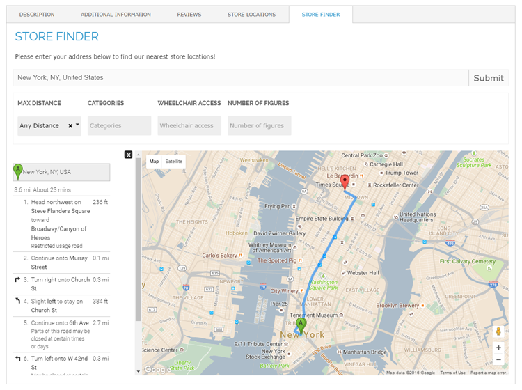
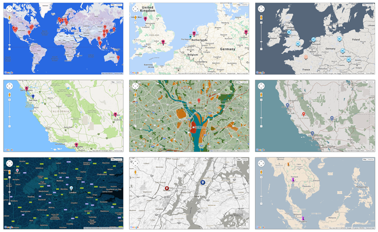

# Store Finder Front-end Examples

Below are front-end examples of a dedicated store page, a Store Locations list page, a Store Finder page with the Google Maps store locator and integrated route planner, the integrated Store Finder product page tabs, and custom store locator themes.

## Store Page

Example of a dedicated store page with uploaded store image, custom store attributes and customer comments.

## Store Locations Overview

Example of Store Locations list page showing custom store images, breadcrumbs navigation and Store Locations and Store Finder links in the top menu.

## Store Finder / Locator

Example Store Finder page with Google Maps based store locator, maximum distance / radius dropdown, store name filter, filterable custom store attributes and integrated route planner. The address bar includes a auto-complete function and optional automatic Geocode detection; distances can be calculated in kilometers or miles.

## Product Page Store Finder

Example of Store Locations overview integrated into the product details menu of the a product page.

Example of Store Finder page integrated into the product details menu of a product page.

## Custom Map Themes

Examples of personalized store locators using custom Google Map themes and uploaded marker icons.

---

[Documentation index](./README.md) · [README](../README.md) · [Online version](https://plugin.company/knowledge-base/docs/magento-store-finder/user-manual/store-finder-frontend-examples/)
